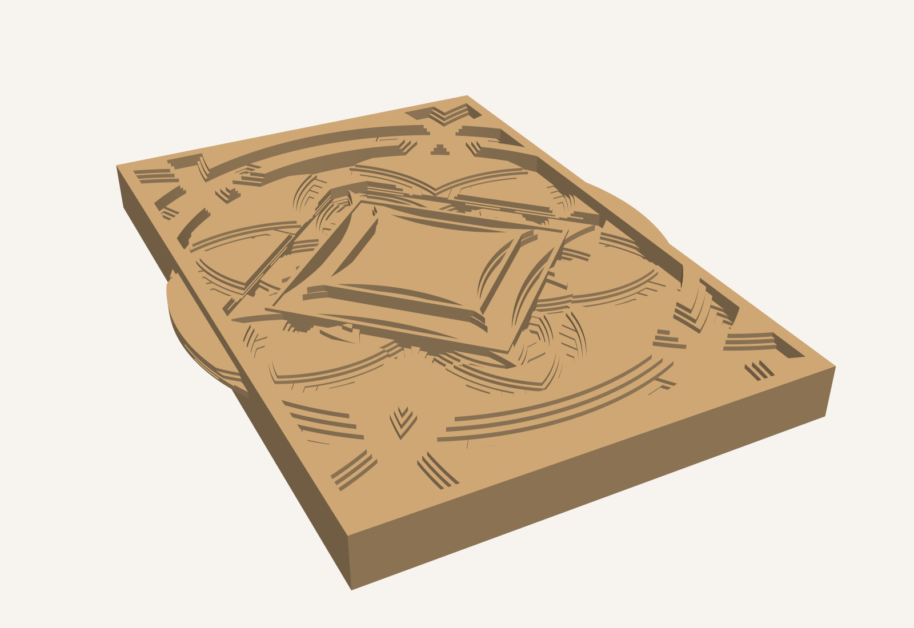
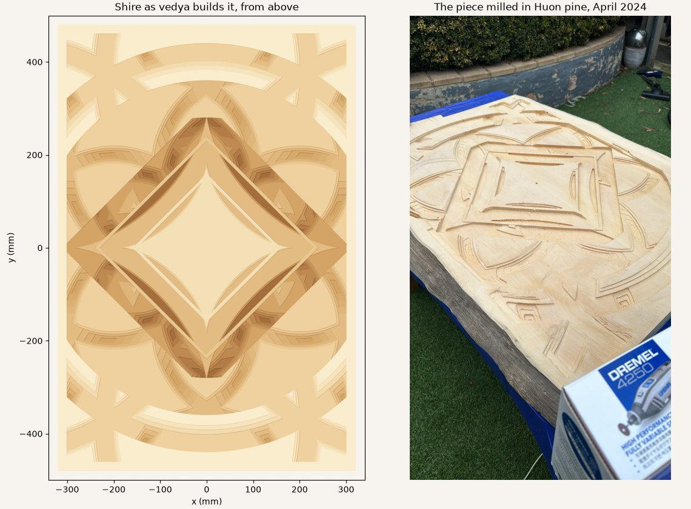
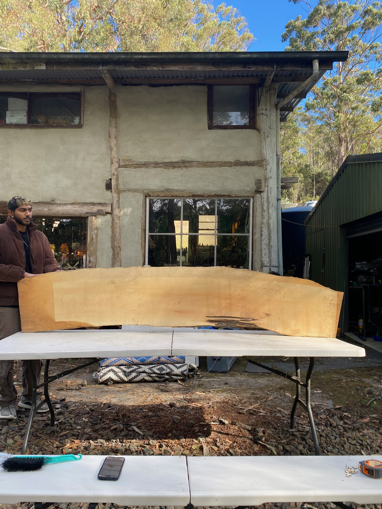
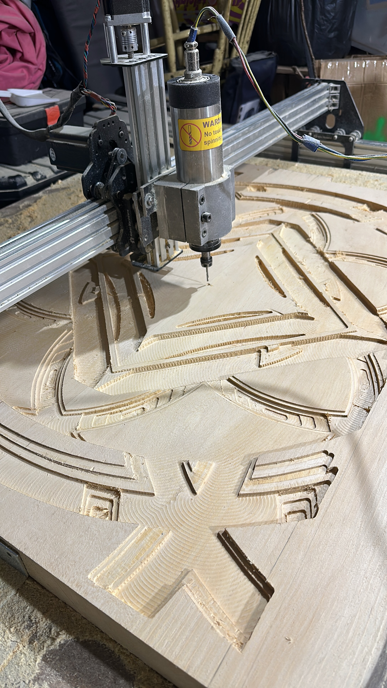
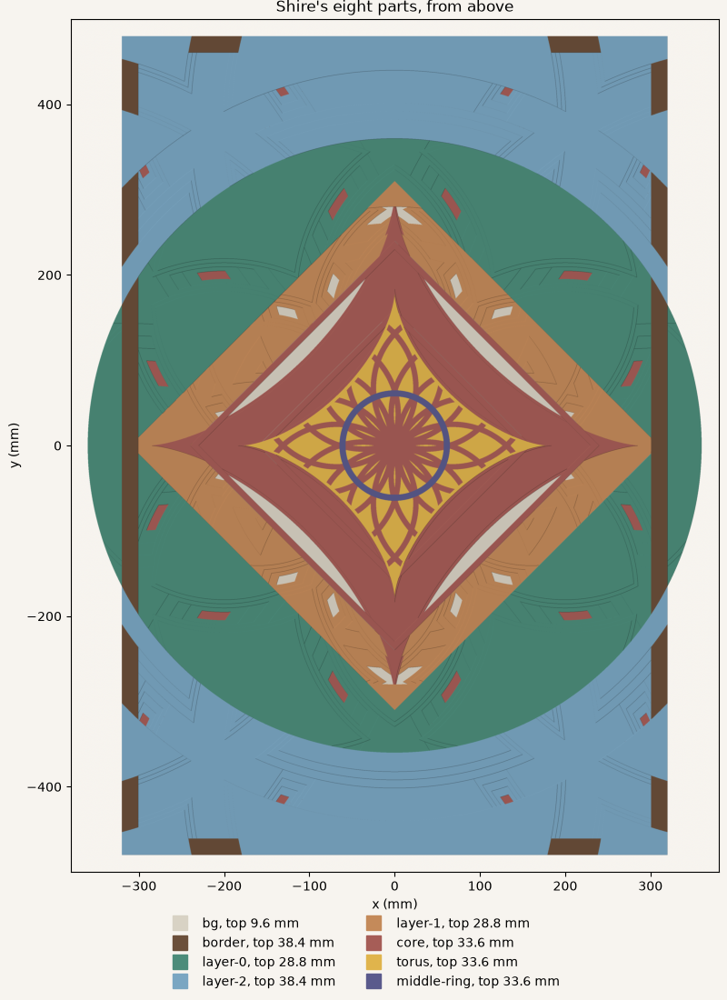
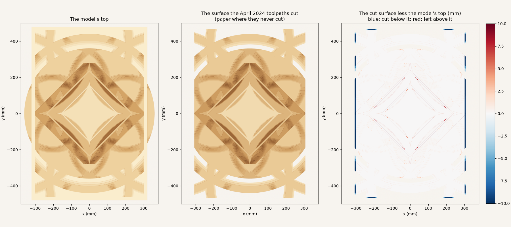
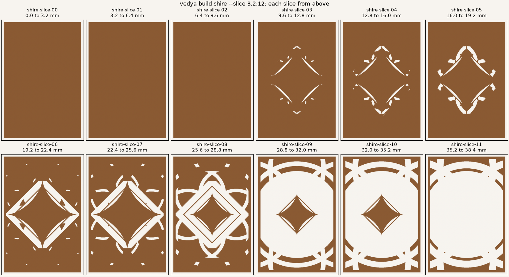
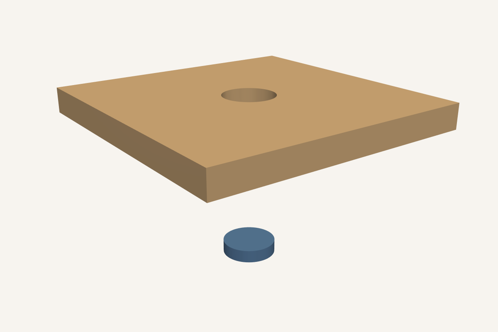
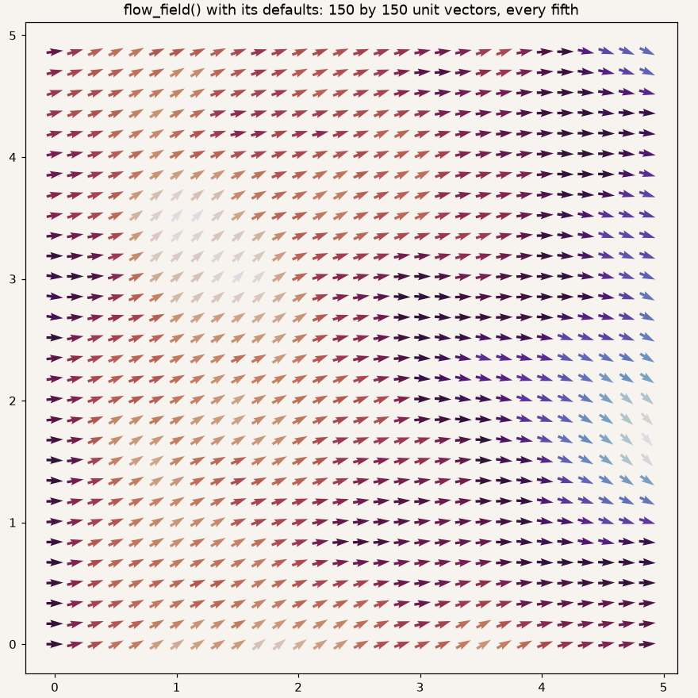

# Vedya



Vedya is Jeevan Pillay's generative design system for geometric reliefs and modular parts, made to be fabricated: CNC milled, laser cut or 3D printed. Each design is a Python function over build123d, an open-source CAD library, and the `vedya` command writes it as STEP, STL or 3MF, in millimetres. This repository holds the package and its two designs: Shire, the relief above, milled in Huon pine in April 2024, and UMSS, a magnetic tile for 3D printing. Both began in 2024 as a script for Autodesk Fusion 360. They are now ported to build123d, and each is checked against what that script built; Shire is also checked against the toolpaths it was milled from.

*Above: `shire.stl`, as `vedya build shire` writes it, rendered with its heights doubled. Every figure in this README is drawn by `make figures` from the designs as the package builds them; the photographs are in `public/`.*

## Shire

- **Project:** Mandala sculpture for the Australia Bush Festival
- **Materials:** Wood (Huon pine), modelling paste, 3D print materials, CNC router materials
- **Dimensions:** Full installation 2 m × 2 m; prototypes vary in size

Shire is a mandala design for the Australia Bush Festival, a collaboration between Jeevan Pillay and Adam Brown, Gemma & team in Tasmania. Its relief of seeds of life, stepped diamonds, astroids and a torus of rings was milled in Huon pine in April 2024, from a board 640 by 960 mm and 38.4 mm deep.



*Left: Shire's top as `vedya` builds it, seen from above and shaded, its board 640 × 960 mm. Right: the piece milled in Huon pine in April 2024 ([`public/final-piece.jpeg`](public/final-piece.jpeg)).*

In the left panel, the circle that reaches past the board's long sides is layer-0's. It overhangs them by up to 40 mm, as the 2024 model did: nothing in the 2024 code trims it, and the milling stayed inside the board, so the piece shows none of it.

<p>
  
  
</p>

## How Shire is built

A design is built from a few primitives in `vedya.geometry` and `vedya.patterns`: circles, rectangles, diamonds (squares turned 45°), astroids, seeds of life and torus rings. Regions on the plane combine with `+`, `-` and `&`; `stroke` draws the band of a given width along a region's outline, on the side `Align` names; and `slab` sweeps a region straight up from a height. Every height in Shire is a whole number of layers, 4.8 mm, or a fraction of one, up to eight layers, 38.4 mm. This is Shire's core, from [`src/vedya/designs/shire.py`](src/vedya/designs/shire.py):

```python
def _core(params: ShireParams) -> bd.Part:
    layer, wall = params.layer, params.wall
    outer, middle, inner = params.diamonds
    low, high = params.astroids
    return union(
        [
            slab(_board(params) - diamond(outer), 2 * layer, 2 * layer),
            slab(stroke(diamond(middle), wall, Align.INSIDE), 2.5 * layer, 3 * layer),
            slab(astroid(low), 2.5 * layer, layer),
            slab(astroid(low - wall), 3 * layer, 2 * layer),
            slab(stroke(diamond(inner), wall, Align.INSIDE), 5 * layer, 2 * layer),
            slab(astroid(high), 5 * layer, layer),
            slab(astroid(high - wall), 6 * layer, layer),
        ]
    )
```

Three of the parts are seed-of-life layers (`seed_layer`): a region carved by seeds of life in two passes, each a stack of steps whose strokes grow with height. Where the passes overlap, the later pass's steps hold. `union` joins a part's slabs band by band, in the plane, where OpenCascade's booleans are reliable ([ADR 0001](docs/adr/0001-build123d-in-millimetres.md)).

Shire's parts, in the order it builds them:

| Part | What it is |
| --- | --- |
| `bg` | The board, two layers (9.6 mm) thick |
| `border` | A wall along the board's edge, inside it; the milled piece had none ([ADR 0003](docs/adr/0003-the-milled-contract.md)) |
| `layer-0` | Seeds of life in the circle of radius 360 mm around the outer diamond, overhanging the board's long sides |
| `layer-2` | Seeds of life on the board outside that circle |
| `layer-1` | Seeds of life between the outer and middle diamonds |
| `core` | The board outside the outer diamond, the diamonds' walls, and four astroids stacked at the centre |
| `torus` | The top astroid less a torus of rings, which lies within the core |
| `middle-ring` | A ring around the centre |



*Shire's eight parts from above, each in its colour, with the height of its top. Where the tops of two parts lie at the same height, the part built later is drawn: so the torus shows on the core, within whose top astroid it lies at the same heights, and layer-2 covers most of the border, which stands to the same 38.4 mm along the board's edge.*

The parameters and their defaults are the fields of `ShireParams` in [`src/vedya/designs/shire.py`](src/vedya/designs/shire.py), and `--set name=value` changes any of them from the command line.

## How it is checked

Each ported design is held to what the 2024 Fusion script built, and Shire to what was milled.

- **Goldens.** [`tests/golden/shire.json`](tests/golden/shire.json) and [`tests/golden/umss.json`](tests/golden/umss.json) hold the volume, area, bounding box and centroid of every part. They were measured by running the 2024 scripts themselves, unchanged, from git history: Shire from commit `a36cc3c` and UMSS from `08f31da`. The scripts run on `tools/legacy/adsk/`, a stand-in for the parts of Fusion's API they call, built on build123d; its contract is at the top of [`tools/legacy/adsk/fusion.py`](tools/legacy/adsk/fusion.py). The fast tests hold every part to its golden, to a relative 1e-6 in volume and area and 0.001 mm in bounding box and centroid. `make golden` regenerates them, and is run only when the stand-in changes, never to make a test pass ([ADR 0002](docs/adr/0002-pin-by-stand-in.md)).
- **The toolpaths.** Shire was milled from two toolpaths, [`public/cnc-cuts/6mm-adaptive.tap`](public/cnc-cuts/6mm-adaptive.tap) and [`3mm-adaptive.tap`](public/cnc-cuts/3mm-adaptive.tap), for flat end mills of 6 and 3 mm. [`tests/test_toolpaths.py`](tests/test_toolpaths.py) follows the tool along every move, no two positions more than 0.25 mm apart, and checks every part but the border against it exactly, in plan: wherever the tool went, the model stands no more than 0.15 mm above its tip, the stock CAM left on floors, anywhere more than 0.1 mm inside the edge of its flat end. The G-code reader and the plan are [`tools/toolpaths.py`](tools/toolpaths.py).
- **The milestone prints.** The slow tests check the stand-in against the STL files Fusion exported for UMSS's first milestone, in `public/umss/` ([notes](public/umss/README.md)).



*Left: the model's top. Middle: the surface the April 2024 toolpaths cut, each 0.25 mm cell as deep as the lowest tool tip that passed over it, and paper where the tools never cut. Right: the cut surface less the model's top: blue where the tools cut below the model, red where they left material above it.*

On the same 0.25 mm cells, `make figures` prints how the cut surface lies against each part's top, over the milled cells the part holds:

| Part | Milled cells | Within 0.2 mm of its top | More than 0.2 mm below it |
| --- | ---: | ---: | ---: |
| `bg` | 201,517 | 92.5% | none |
| `border` | 158,336 | none | 100% |
| `layer-0` | 2,869,588 | 98.3% | none |
| `layer-2` | 1,912,280 | 99.1% | none |
| `layer-1` | 1,138,460 | 98.0% | none |
| `core` | 1,473,036 | 98.6% | none |
| `torus` | 288,301 | 100% | none |
| `middle-ring` | 44,360 | 100% | none |

No milled cell lies more than 0.2 mm below any part but the border, and every milled cell of the border does: the piece was milled with no wall along the board's edge, the open question in [ADR 0003](docs/adr/0003-the-milled-contract.md). Elsewhere, the cells not within 0.2 mm lie above the model, along its walls, where the tools left material.

[ADR 0001](docs/adr/0001-build123d-in-millimetres.md) records why Vedya is built on build123d in millimetres, [ADR 0002](docs/adr/0002-pin-by-stand-in.md) why the ported designs are pinned by a stand-in, and [ADR 0003](docs/adr/0003-the-milled-contract.md) why Shire reproduces the model that was milled, with the toolpath measurements. [`CONTEXT.md`](CONTEXT.md) defines the words the code uses.

The Fusion 360 code is no longer in the tree. Three tags keep its last states:

| Tag | Commit | What it marks |
| --- | --- | --- |
| `fusion/milled` | `57f2b02` | The April 2024 script whose Shire model was milled into the finished piece |
| `fusion/shire-last` | `a36cc3c` | The last commit at which Shire, its slicer and its aggregator import (August 2024) |
| `fusion/head` | `08f31da` | The last Fusion state of `master`, which builds only UMSS, with the 2024 library under `src/lib/` |

`git show fusion/milled:src/api-vedya-draw/APIDrawVedya.py` prints the script that was milled.

## Fabrication

```sh
uv run vedya build shire --out out/
```

This writes each of Shire's eight parts as `out/shire-<part>.stl` and `.step`, and all of them joined into one, the aggregate, as `out/shire.stl` and `out/shire.step`. Shire takes about half a minute. Options choose what is written:

- Given alone, `--parts` writes only the parts, and `--aggregate` only their union.
- `--format stl,step,3mf` chooses the formats; the default is `stl,step`.
- `--set name=value` changes a parameter. Lengths are in millimetres.

**STEP** keeps the exact geometry. **STL** and **3MF** are triangle meshes that stay within 0.01 mm of the exact surface, and a 3MF file holds one closed mesh, as a slicer expects.

```sh
uv run vedya build shire --aggregate --slice 3.2:12 --format stl,3mf --out out/sliced
```

`--slice H:N` joins the parts and cuts the result into layers H mm high from the bottom up, at most N cuts. Each layer is written as `<design>-slice-<i>`, from `00` at the bottom; the last is what is left above the last cut. Shire, 38.4 mm high, gives twelve layers of 3.2 mm, `shire-slice-00` to `shire-slice-11`, for a slicer such as BambuStudio or for laser cutting.



*The twelve slices of `--slice 3.2:12`, each seen from above. Layer-0's circle shows past the board in `shire-slice-06` to `shire-slice-08`, from 19.2 to 28.8 mm, where it stands.*

## UMSS

UMSS is a magnetic tile for the Universal Modular Storage System, a fork of Printables model 947943, in 32 mm squares, with a pocket for a cylindrical magnet 6 mm across and 3 mm high. Its parts are the `tile`, 32 mm square and 3 mm thick, with a hole of radius 3.1 mm through its centre; the `magnet-base`, the disc the Fusion script built last, which is what `vedya build umss` builds by default; and the `base-ring`, a 1 mm wall around the magnet base. The parameters are the fields of `UmssParams` in [`src/vedya/designs/umss.py`](src/vedya/designs/umss.py).



*The tile with its hole, and the magnet base, moved 14 mm down from where it is built so that both show.*

```sh
uv run vedya build umss --set parts=tile,magnet-base --out out/umss
uv run vedya build umss --set parts=tile --set hole_radius=3.0 --out out/m1
```

The first writes the two parts shown, and their union. The second writes the tile of the first printed milestone, with a hole of radius 3.0 mm; that milestone printed radii from 3.0 to 3.5 mm, and [`public/umss/README.md`](public/umss/README.md) records how each fitted.

## The library's other tools

The 2024 code had a small library beside the Fusion script. Its functions are now `vedya.mapping`, `vedya.render` and `vedya.flowfield`, behind three commands. `stencil` and `map --figure` need the `render` extra, and `flowfield` the `examples` extra; `uv sync --all-extras` installs both.

```sh
uv run vedya map cylinder --out out/cylinder.csv --figure out/cylinder.html
uv run vedya stencil public/stencil/roman-soldier-cc.png --out out/stencil.png
uv run vedya flowfield --out out/flowfield.npy
```

- `map cylinder|sphere` wraps a rectangle's cells and a disc's rings onto a cylinder or a sphere, and writes the points as CSV, and with `--figure` as a 3D figure in HTML.
- `stencil` writes an image's outlines in black on white.
- `flowfield` writes a grid of unit vectors whose angles follow Perlin noise, as a NumPy array.



*`flow_field()` with its defaults: a grid of 150 by 150 unit vectors whose angles follow Perlin noise, every fifth across and up drawn, coloured by its angle.*

`uv run vedya <command> --help` lists each command's options.

## Quick start

You need Python 3.12 or newer and uv.

```sh
uv sync
uv run vedya list
uv run vedya build shire --out out/
```

`uv sync` installs the package and its development tools. `vedya list` names each design with a line about it, `shire` and `umss`, and `vedya build shire --out out/` writes Shire's parts and aggregate into `out/`, which git ignores. `uv sync --all-extras`, or `make sync` from the lock file exactly, also installs what `vedya stencil`, `vedya map --figure` and `vedya flowfield` need.

## Development

```sh
make check    # ruff, ruff format, pyright in strict mode, and the fast tests
make slow     # the slow tests: the 2024 code from git history, and the toolpaths
make golden   # rerun the 2024 code and rewrite tests/golden/
make figures  # build the designs and redraw every image in docs/images/
```

`make check` is the default target and takes about a minute. `make slow` takes a few minutes and reads old commits, so it needs a clone with full history; in a shallow clone, run `git fetch --unshallow` first. `make golden` is run only when the stand-in changes. `make figures` runs [`tools/figures.py`](tools/figures.py) with the `docs` dependency group, matplotlib, Pillow and pyvista, which neither `uv sync` nor CI installs; it takes about a minute, prints the toolpath table above, and a second run on the same machine writes the same files. `make designs` builds every design into `out/`, `make format` fixes what ruff can, and `make hooks` installs the pre-commit hooks.

CI runs the lint job, the fast tests on Linux (Python 3.12, 3.13 and 3.14), macOS and Windows (3.13), and the slow tests on Linux. [`AGENTS.md`](AGENTS.md) holds the working rules for changing geometry, the stand-in and the goldens.

```text
src/vedya/          the package: geometry, patterns, model, export, the CLI, and designs/
tests/              the tests; golden/ holds the goldens
tools/legacy/       the stand-in for Fusion's API, and the tools that run the 2024 scripts
tools/toolpaths.py  the G-code reader and the plan of a model from above
tools/figures.py    the README's figures
docs/adr/           the decisions
docs/images/        the README's figures, as make figures writes them
public/             photographs, toolpaths, prints, laser cuts, scans; umss/ and stencil/
CONTEXT.md          the domain words
```

[`.gitattributes`](.gitattributes) routes STL, 3MF, MP4, Blender, OBJ and Fusion files through Git LFS, except in `public/umss/`, so outside that folder the files under `public/` with those suffixes are LFS pointers. The files the tests read, in `public/umss/`, `public/cnc-cuts/` and `public/stencil/`, are stored in full. Notes on the 3D prints are in [`public/3d-printer-prototypes/README.md`](public/3d-printer-prototypes/README.md).

## Licence

Vedya is Jeevan Pillay's work, free to reproduce and not to sell. The code is under the [PolyForm Noncommercial License 1.0.0](LICENSE): anyone may use, change and share it for any noncommercial purpose. The photographs, videos, models and toolpaths are under [Creative Commons Attribution-NonCommercial 4.0](LICENSE-MEDIA): anyone may copy, share and adapt them for noncommercial purposes, crediting Jeevan Pillay. The stencil example's input image, `roman-soldier-cc.png`, and the `stencil_output.png` made from it, are third-party material and covered by neither licence.
