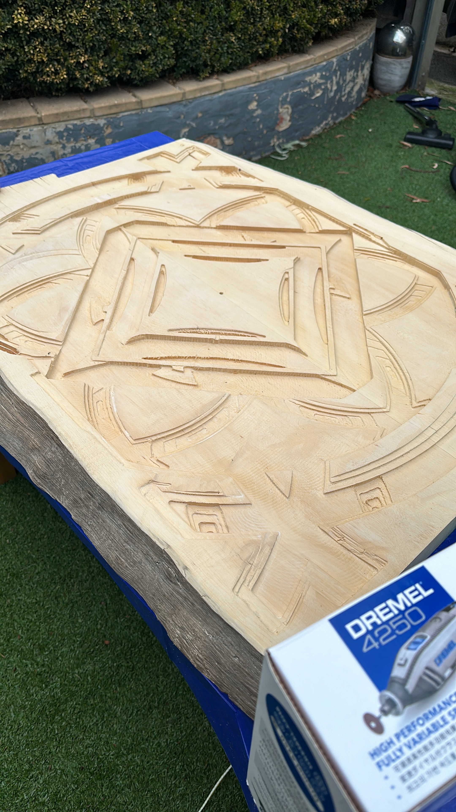
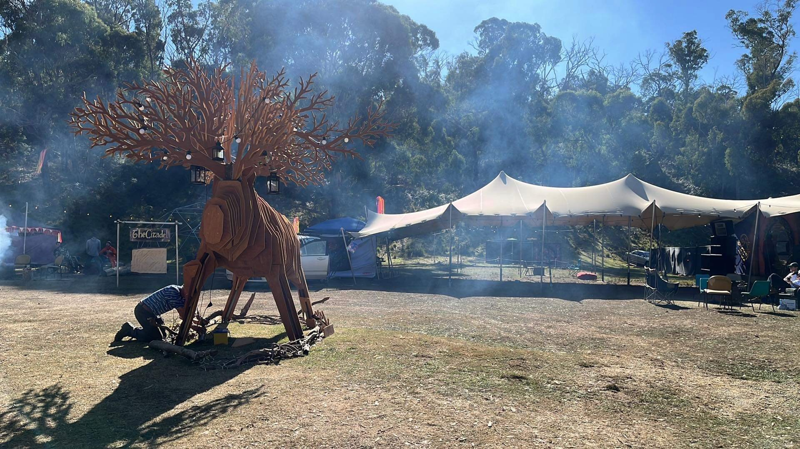

# Vedya

Vedya is a generative design system for geometric reliefs and modular parts, made to be fabricated: CNC milled, laser cut or 3D printed. Each design is a Python function over [build123d](https://github.com/gumyr/build123d), an open-source CAD library, and the `vedya` command writes it as STEP, STL or 3MF, in millimetres.

It began in 2024 as a script for Autodesk Fusion 360. That script is now ported to build123d, and the port is held to what the script built: see [How the port is checked](#how-the-port-is-checked).

## Shire



- **Project:** Mandala sculpture for the Australia Bush Festival
- **Materials:** Wood (Huon pine), modelling paste, 3D print materials, CNC router materials
- **Dimensions:** Full installation 2 m × 2 m; prototypes vary in size

Shire is a mandala design for the Australia Bush Festival, a collaboration between Jeevan Pillay and Adam Brown, Gemma & team in Tasmania. Its relief of seeds of life, stepped diamonds, astroids and a torus of rings was milled in Huon pine in April 2024, from a board 640 by 960 mm and 38.4 mm deep.




The repository's second design, UMSS, is a magnetic tile for the Universal Modular Storage System: a 32 mm square with a pocket for a cylindrical magnet 6 mm across and 3 mm high.

## Install

You need Python 3.12 or newer and [uv](https://docs.astral.sh/uv/).

```sh
uv sync                 # the package and its development tools
uv sync --all-extras    # also what `vedya stencil`, `vedya map --figure` and `vedya flowfield` need
```

`make sync` does the second, from the lock file exactly.

## Build a design

```sh
uv run vedya list
uv run vedya build shire --out out/
```

`vedya list` names each design with a line about it: `shire` and `umss`. `vedya build shire --out out/` writes each of Shire's eight parts, as `out/shire-<part>.stl` and `.step`, and all of them joined into one, as `out/shire.stl` and `out/shire.step`. Shire takes about half a minute.

Shire's parts, in the order it builds them:

| Part | What it is |
| --- | --- |
| `bg` | The board, two layers (9.6 mm) thick |
| `border` | A wall along the board's edge, inside it; the milled piece had none ([ADR 0003](docs/adr/0003-the-milled-contract.md)) |
| `layer-0` | Seeds of life in the circle around the outer diamond |
| `layer-2` | Seeds of life on the board outside that circle |
| `layer-1` | Seeds of life between the outer and middle diamonds |
| `core` | The board outside the outer diamond, the diamonds' walls, and four astroids stacked at the centre |
| `torus` | The top astroid less a torus of rings, which lies within the core |
| `middle-ring` | A ring around the centre |

Options choose what is written:

- Given alone, `--parts` writes only the parts, and `--aggregate` only their union.
- `--format stl,step,3mf` chooses the formats; the default is `stl,step`.
- `--set name=value` changes a parameter, such as `--set hole_radius=3.0`. The parameters and their defaults are the fields of `ShireParams` in [`src/vedya/designs/shire.py`](src/vedya/designs/shire.py) and `UmssParams` in [`src/vedya/designs/umss.py`](src/vedya/designs/umss.py). Lengths are in millimetres.

UMSS builds its magnet base by default. Its first printed milestone, a tile with a 3.0 mm hole, is:

```sh
uv run vedya build umss --set parts=tile --set hole_radius=3.0 --out out/m1
```

### Slicing and formats

```sh
uv run vedya build shire --aggregate --slice 3.2:12 --format stl,3mf --out out/sliced
```

`--slice H:N` joins the parts and cuts the result into layers H mm high from the bottom up, at most N cuts. Each layer is written as `<design>-slice-<i>`, from `00` at the bottom; the last is what is left above the last cut. Shire, 38.4 mm high, gives twelve layers of 3.2 mm, `shire-slice-00` to `shire-slice-11`, ready for a slicer such as BambuStudio or for laser cutting.

- **STEP** keeps the exact geometry.
- **STL** and **3MF** are triangle meshes that stay within 0.01 mm of the exact surface. A 3MF file holds one closed mesh, as a slicer expects.

### The library's other tools

The 2024 code had a small library beside the Fusion script. Its functions are now `vedya.mapping`, `vedya.render` and `vedya.flowfield`, behind three commands. `stencil` and `map --figure` need the `render` extra, and `flowfield` the `examples` extra; `uv sync --all-extras` installs both.

```sh
uv run vedya map cylinder --out out/cylinder.csv --figure out/cylinder.html
uv run vedya stencil public/stencil/roman-soldier-cc.png --out out/stencil.png
uv run vedya flowfield --out out/flowfield.npy
```

- `map cylinder|sphere` wraps a rectangle's cells and a disc's rings onto a cylinder or a sphere, and writes the points as CSV, and with `--figure` as a 3D figure in HTML.
- `stencil` writes an image's outlines in black on white.
- `flowfield` writes a grid of unit vectors whose angles follow Perlin noise, as a NumPy array.

`uv run vedya <command> --help` lists each command's options.

## Run the checks

```sh
make check    # ruff, ruff format, pyright in strict mode, and the fast tests
make slow     # the slow tests: the 2024 code from git history, and the toolpaths
make golden   # rerun the 2024 code and rewrite tests/golden/
make designs  # build every design into out/
```

`make check` is the default target and takes about a minute. `make slow` takes a few minutes and reads old commits, so it needs a clone with full history; in a shallow clone, run `git fetch --unshallow` first. `make format` fixes what ruff can, and `make hooks` installs the pre-commit hooks.

CI runs the lint job, the fast tests on Linux (Python 3.12, 3.13 and 3.14), macOS and Windows (3.13), and the slow tests on Linux.

## How the port is checked

Each ported design is held to what the 2024 Fusion script built.

- **Goldens.** `tests/golden/umss.json` and `tests/golden/shire.json` hold the volume, area, bounding box and centroid of every part. They were measured by running the 2024 scripts themselves, unchanged, from git history: UMSS from commit `08f31da` and Shire from `a36cc3c`. The scripts run on `tools/legacy/adsk/`, a stand-in for the parts of Fusion's API they call, built on build123d. The fast tests hold every part to its golden. `make golden` regenerates them, and is run only when the stand-in changes, never to make a test pass.
- **Outside records.** The slow tests check the stand-in against the STL files Fusion exported for UMSS's first milestone, in [`public/umss/`](public/umss/README.md), and check Shire against the April 2024 toolpaths it was milled from, in [`public/cnc-cuts/`](public/cnc-cuts/).

[`docs/adr/`](docs/adr/) records why: [0001](docs/adr/0001-build123d-in-millimetres.md) build123d in millimetres, [0002](docs/adr/0002-pin-by-stand-in.md) the pin by a stand-in, and [0003](docs/adr/0003-the-milled-contract.md) the milled model as the contract, with the toolpath measurements. [`CONTEXT.md`](CONTEXT.md) defines the words the code uses.

## The Fusion 360 code

The Fusion 360 code is no longer in the tree. Three tags keep its last states:

| Tag | Commit | What it marks |
| --- | --- | --- |
| `fusion/milled` | `57f2b02` | The April 2024 script whose Shire model was milled into the finished piece |
| `fusion/shire-last` | `a36cc3c` | The last commit at which Shire, its slicer and its aggregator import (August 2024) |
| `fusion/head` | `08f31da` | The last Fusion state of `master`, which builds only UMSS, with the 2024 library under `src/lib/` |

`git show fusion/milled:src/api-vedya-draw/APIDrawVedya.py` prints the script that was milled.

## The repository

```text
src/vedya/          the package: geometry, patterns, model, export, the CLI, and designs/
tests/              the tests; golden/ holds the goldens
tools/legacy/       the stand-in for Fusion's API, and the tools that run the 2024 scripts
public/             photographs, toolpaths, prints, laser cuts, scans; umss/ and stencil/
docs/adr/           the decisions
CONTEXT.md          the domain words
```

Outside `public/umss/`, the files under `public/` whose suffixes [`.gitattributes`](.gitattributes) routes through Git LFS (STL, 3MF, MP4, Blender, OBJ and Fusion files) are LFS pointers. The files the tests read, in `public/umss/`, `public/cnc-cuts/` and `public/stencil/`, are stored in full. Notes on the 3D prints are in [`public/3d-printer-prototypes/README.md`](public/3d-printer-prototypes/README.md).

## Licence

Vedya is Jeevan Pillay's work, free to reproduce and not to sell. The code is under the [PolyForm Noncommercial License 1.0.0](LICENSE): anyone may use, change and share it for any noncommercial purpose. The photographs, videos, models and toolpaths are under [Creative Commons Attribution-NonCommercial 4.0](LICENSE-MEDIA): anyone may copy, share and adapt them for noncommercial purposes, crediting Jeevan Pillay. The stencil example's input image, `roman-soldier-cc.png`, and the `stencil_output.png` made from it, are third-party material and covered by neither licence.
